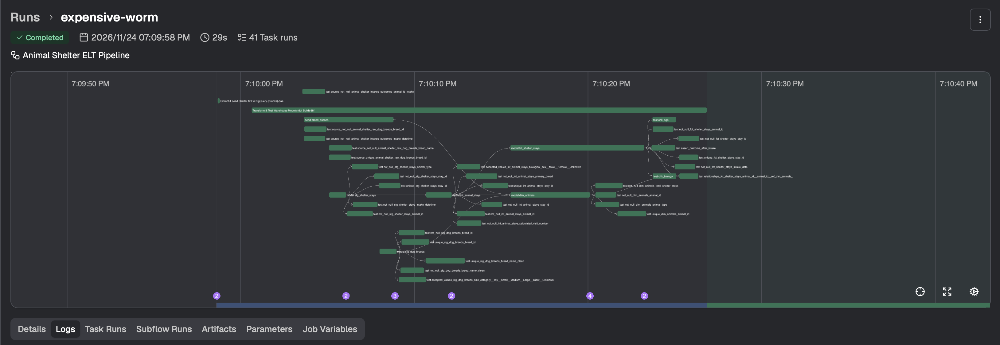
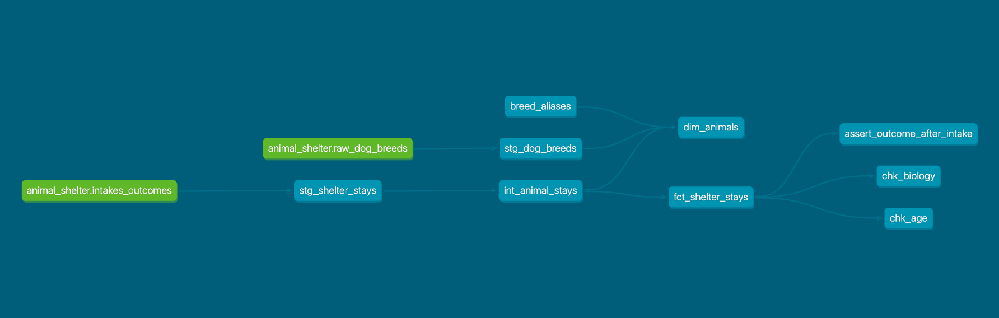
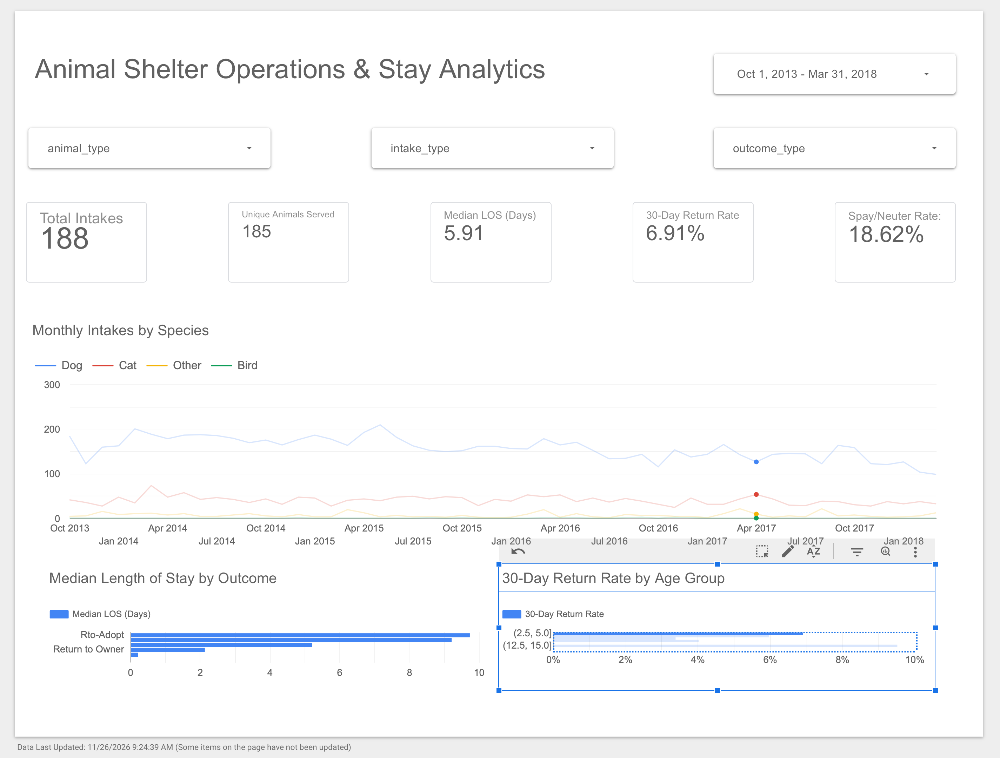

# Animal Shelter Operations & Stay Analytics ELT
[](https://github.com/lvoynich/shelter-analytics-elt/actions/workflows/ci.yml)

An end-to-end, containerized data and analytics engineering pipeline built with **Prefect 3**, **Python**, **dbt Core**, **Google BigQuery**, **SQL**, and **Looker Studio** to ingest reference API data, transform ~80,000 raw animal shelter records into a governed Kimball star schema, and deliver self-serve operational analytics via a live BI dashboard.


---

## Project Overview

Municipal animal shelter datasets often arrive as wide, flat exports containing duplicate stay records, inconsistent string formatting, mixed-breed text fields, and open stays without outcomes. This project applies modern data and analytics engineering best practices—automated workflow orchestration, fault-tolerant API ingestion, medallion architecture, surrogate key generation, window-function event sequencing, BigQuery partitioning/clustering, and automated data quality testing—to turn raw operational logs into reliable analytical models.

### Orchestrated Architecture & Medallion Layers

```text
                       [Prefect 3 Orchestrator: flow.py]
                                       │
          ┌────────────────────────────┴────────────────────────────┐
          ▼ (Task 1: retries=3, backoff)                            ▼ (Task 2: fail-fast gate)
[Python REST API Ingestion]                               [dbt Core Build & Test]
   └── src/ingest_dog_breeds.py                              └── shelter_warehouse/
          │                                                         │
          ▼                                                         ▼
[Bronze: BigQuery Raw Sources] ──────────────────────────► [Silver: Staging & Enrichment Views]
   ├── animal_shelter.intakes_outcomes (~80k rows)            ├── stg_shelter_stays (Deduplication, MD5 keys)
   └── animal_shelter.dog_breeds (631 API records)            └── int_animal_stays  (Breed/sex parsing, LAG/ROW_NUMBER)
                                                                    │
                                                                    ▼
                                                           [Gold: Kimball Star Schema & BI View]
                                                              ├── dim_animals           (Clustered by species & breed)
                                                              ├── fct_shelter_stays     (Partitioned by intake_date)
                                                              └── rpt_shelter_dashboard (Denormalized BI view + dbt exposure)
                                                                       │
                                                                       ▼
                                                           [Looker Studio Executive Dashboard]
                                                              └── Live BigQuery connector (Partition-pruned, cross-filtered)
```





*(Note: To view the interactive data dictionary and lineage DAG locally, run `dbt docs generate && dbt docs serve` inside `shelter_warehouse/`.)*

## Interactive BI Dashboard (Looker Studio)

**[View Live Interactive Dashboard](https://datastudio.google.com/reporting/76744b73-6133-4d75-bf3f-f4669f703f96/page/qXOEG)**



To serve self-service operational metrics without slow client-side data blending, a flattened BigQuery reporting view (`rpt_shelter_dashboard`) joins `fct_shelter_stays` and `dim_animals` and is registered as a governed **dbt exposure** (`exposures.yml`).

* **Executive KPI Scorecards:** Tracks Total Intakes, Unique Animals Served, Median Length of Stay (Days), 30-Day Return Rate, and In-Shelter Spay/Neuter Conversion Rate.
* **Partition-Pruned Filtering:** Interactive controls for `intake_date` (pushing predicates down to BigQuery monthly partitions), `animal_type`, `intake_type`, and `outcome_type`, plus cross-filtering across all visuals.
* **Operational Breakdowns:** Visualizes monthly intake seasonality by species, median length of stay across outcome paths, and 30-day return rates by intake age group.


### Key Engineering Highlights
* **Workflow Orchestration (`flow.py` / Prefect 3):** Coordinates end-to-end execution order between Python extraction and dbt transformations using `PrefectDbtRunner`. Enforces automated task retries (`retries=3` with delay) on external API ingestion and fail-fast dependency gating (`raise_on_failure=True`) so downstream Gold tables never update if upstream ingestion or data quality tests fail.
* **Cloud Data Warehousing (BigQuery):** Gold fact tables are configured with **monthly date partitioning** (`intake_date`) and **multi-column clustering** (`animal_type`, `outcome_type`, `primary_breed`) to minimize query scan costs and improve performance.
* **Window-Function Event Sequencing:** Uses `ROW_NUMBER()`, `COUNT(*) OVER (...)`, and `LAG()` partitioned by `animal_id` to reconstruct multi-visit animal histories, calculate days between stays, and flag 30-day returns.
* **Attribute Standardization:** Parses raw breed strings into `primary_breed`, `secondary_breed`, and `is_mixed_breed`, while separating biological sex from reproductive status to track in-shelter spay/neuter conversions (`was_altered_during_stay`).
* **Automated Data Governance (26/26 Checks Passing):** Enforces `unique`, `not_null`, `accepted_values`, and foreign-key `relationships` tests across every layer of the DAG.
* **Python API Ingestion (`src/ingest_dog_breeds.py`):** Extracts 631 canine breed records from The Dog API with exponential-backoff retries, structured logging, and explicit BigQuery schema enforcement (`WRITE_TRUNCATE`).
* **Entity Resolution via `dbt seed` (`breed_aliases.csv`):** Resolves municipal shelter breed shorthand and applies AKC size fallbacks, boosting canine breed match rates from 59.6% to **99.5%**.
* **Incremental `MERGE` & CI/CD:** Materializes `fct_shelter_stays` incrementally on `stay_id` (updating newly closed open stays) and validates every push via GitHub Actions (`ruff`, `sqlfluff`, and `dbt parse`).
* **Semantic BI Layer & dbt Exposures (`rpt_shelter_dashboard` / `exposures.yml`):** Exposes a denormalized BigQuery reporting view over the Gold star schema and registers the live Looker Studio dashboard as a downstream dbt exposure to preserve end-to-end lineage and partition-pruned BI performance.

---

## Data Quality Findings & Resolutions

* **Duplicate Stay Records (`unique_stg_shelter_stays_stay_id`):**
  * **Finding:** Initial staging validation uncovered 26 duplicate `stay_id` keys (`animal_id` + `intake_datetime` + `intake_visit_number`), with some records repeated up to 4 times due to upstream export join fan-out.
  * **Resolution:** Implemented `QUALIFY ROW_NUMBER()` deduplication in `stg_shelter_stays.sql` partitioned by `stay_id`, resolving all duplicates and achieving 100% primary-key uniqueness.

* **Intake Age Estimation Discrepancies (`chk_age`):**
  * **Finding:** Custom age validation (`age_upon_outcome_days < age_upon_intake_days`) flagged 152 stays where recorded outcome age was lower than intake age—primarily concentrated in sequential litter intakes (e.g., `A764890`–`A764898`) where staff estimated 5 weeks (`35` days) at intake and refined the birth date to 1 month (`30` days) at outcome.
  * **Resolution:** Configured `chk_age.sql` with `severity = 'warn'` to maintain observability over source estimation adjustments without blocking downstream mart builds.

* **Canine Breed Entity Resolution (`breed_aliases.csv`):**
  * **Finding:** Direct joining between shelter `primary_breed` strings and The Dog API left 40.4% of shelter dogs unmatched (`Unknown` size) due to municipal shorthand (e.g., `"Pit Bull"`, `"Chihuahua Shorthair"`) and missing API weights.
  * **Resolution:** Iteratively built a 37-row `dbt seed` crosswalk with fallback AKC size tiers, reducing `Unknown` dog sizes from 40.4% down to **0.5%** (a **99.5% match rate**).

---

## What This Warehouse Answers

Once built in BigQuery, the Gold star schema and reporting layer support self-serve operational analysis across key shelter metrics:
* **30-Day Return Rates:** Tracking how often adopted animals return within 30 days by species, age group, or intake type.
* **Length of Stay (LOS) Drivers:** Comparing average and median shelter duration across mixed vs. purebred animals, intake conditions, and outcome categories.
* **In-Shelter Spay/Neuter Impact:** Measuring how many intact animals are altered during their stay (`was_altered_during_stay`) and how that affects adoption timelines.
* **Multi-Visit Recidivism & Unique Population:** Contrasting total stay volume against unique animals served (`animal_id`) to quantify repeat intakes across the shelter's historical timeline.

---

## Repository Structure

```text
shelter-analytics-elt/
├── .dockerignore                      # Excludes credentials, .venv, and local dbt artifacts from image

├── .github/
│   └── workflows/
│       └── ci.yml                     # Automated Ruff, SQLFluff, and dbt parse CI pipeline
├── .gitignore                         # Excludes virtual environments, dbt artifacts, and credentials
├── assets/
│   ├── lineage_dag.png                # dbt model lineage DAG
│   └── prefect_flow_run.png           # Prefect 3 orchestrated flow run graph
├── Dockerfile                         # Slim Python 3.11 Linux container definition

├── flow.py                            # Prefect 3 ELT orchestration pipeline (API ingest + dbt build)
├── README.md                          # Project overview, architecture, and setup guide
├── requirements.txt                   # Python dependencies (prefect[dbt], dbt-bigquery, google-cloud-bigquery, requests)
├── src/
│   ├── __init__.py                    # Marks src/ as an importable Python package
│   └── ingest_dog_breeds.py           # REST API ingestion script loading 631 breeds into BigQuery
└── shelter_warehouse/                 # dbt Core project directory
    ├── dbt_project.yml                # Project configuration and materialization rules
    ├── models/
    │   ├── staging/
    │   │   ├── sources.yml            # Raw BigQuery source definitions & source tests
    │   │   ├── stg_shelter_stays.sql  # Staging cleanup, surrogate keys, and deduplication
    │   │   └── stg_shelter_stays.yml  # Staging column documentation & data tests
    │   ├── intermediate/
    │   │   ├── int_animal_stays.sql   # Breed/sex parsing & repeat-visit window functions
    │   │   └── int_animal_stays.yml   # Intermediate documentation & accepted_values tests
    │   └── marts/
    │       ├── dim_animals.sql        # Gold animal dimension table (clustered)
    │       ├── fct_shelter_stays.sql  # Gold shelter stay fact table (partitioned & clustered)
    │       └── marts.yml              # Star schema documentation & foreign-key relationship tests
    └── tests/
        ├── assert_outcome_after_intake.sql
        ├── chk_age.sql
        └── chk_biology.sql
```

---

### Custom Singular Tests (`shelter_warehouse/tests/`)
* **`chk_biology.sql`:** Uses `LAG()` window functions partitioned by `animal_id` to verify biological consistency across repeat visits, confirming zero animals reverted from `Altered` back to `Intact`.
* **`chk_age.sql`:** Monitors stays where outcome age is lower than intake age (`severity = 'warn'`), isolating bulk litter age-estimation adjustments.
* **`assert_outcome_after_intake.sql`:** Enforces chronological integrity by verifying no closed stay has an outcome timestamp prior to intake.

---

## Tech Stack

* **Orchestration:** Prefect 3 (`prefect-dbt`)
* **Containerization:** Docker (`python:3.11-slim` Linux runtime)
* **Data Warehouse:** Google BigQuery
* **Transformation & Testing:** dbt Core (`dbt-bigquery`)
* **Languages:** Python, SQL (GoogleSQL), YAML, Jinja
* **CI/CD & Tooling:** GitHub Actions, Ruff, SQLFluff, Google Cloud CLI, Git/GitHub
* **Local Development:** macOS, VS Code, Python `.venv`, Google Cloud CLI, Git/GitHub

---

## Local Setup & Usage

1. **Clone the repository and activate a virtual environment:**
   ```bash
   git clone https://github.com
   cd shelter-analytics-elt
   python3 -m venv .venv
   source .venv/bin/activate
   pip install -r requirements.txt
   ```

2. **Configure Google Cloud & dbt credentials:**
   * Authenticate with BigQuery (`gcloud auth application-default login` or configure a service account key).
   * Ensure `~/.dbt/profiles.yml` contains a `shelter_warehouse` profile pointing to your GCP project and dataset.

3. **Run the orchestrated ELT pipeline with Prefect:**
   * *(Optional)* Start the local Prefect UI server in a separate terminal:
     ```bash
     prefect server start
     prefect config set PREFECT_API_URL="http://localhost:4200/api"
     ```
   * Execute the end-to-end flow (REST API ingestion followed by `dbt build`):
     ```bash
     python flow.py
     ```

4. **Run the containerized pipeline with Docker (optional):**
   Build the portable Linux image and mount your local dbt profile and Google Cloud credentials as read-only volumes at runtime:
   ```bash
   docker build -t animal-shelter-elt .

   docker run --rm \
     -v ~/.dbt:/root/.dbt:ro \
     -v ~/.config/gcloud:/root/.config/gcloud:ro \
     animal-shelter-elt
   ```
5. **Run standalone dbt commands (optional):**
   ```bash
   cd shelter_warehouse
   dbt build
   ```
